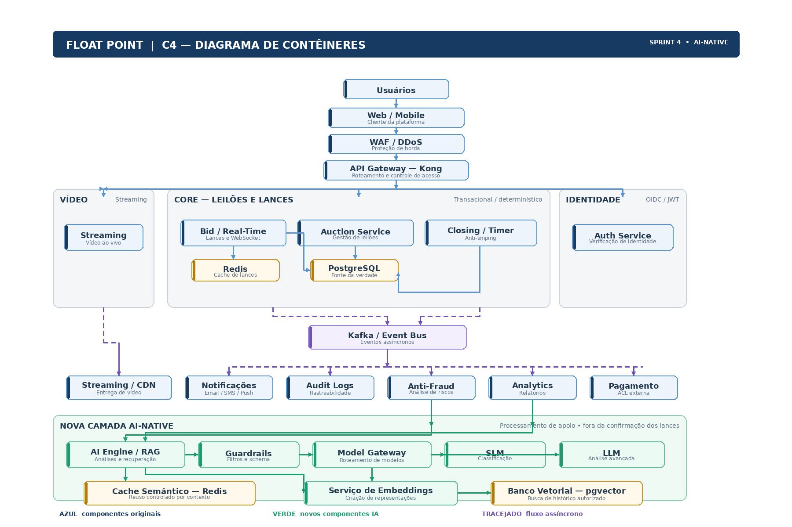
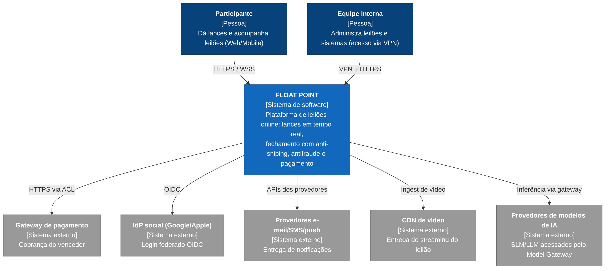
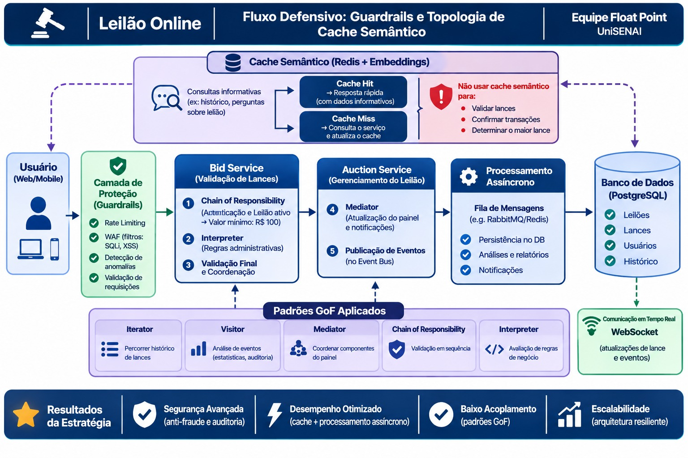

# FLOAT POINT — Sistema de Leilões Online

## Identificação da Equipe

UniSENAI — Engenharia de Software, Arquitetura de Software, novembro de 2026.

| Nome do Integrante | Função na Sprint 4 (Liderança / Pesquisador / Executor) | GitHub |
|---|---|---|
| Rodrigo Rodrigues dos Santos Junior    | Líder | [@RRS1235](https://github.com/RRS1235) |
| Edson Ristow      | Pesquisador;       | [@Ritow18](https://github.com/Ritow18) |
| William Martins   | Executor;          | [@WozyMarty](https://github.com/WozyMarty) |
| Yuji Kanenobu     | Pesquisador;       | [@Valfako](https://github.com/Valfako) |
| João Pedro Alves  | Executor;          | [@JoaoAlves0014](https://github.com/JoaoAlves0014) |

s
## 1. Visão Geral do Sistema e Domínio de Negócio

### 1.1. Contexto do Projeto Selecionado

**Architectural Kata:** 4. Going... Going... Gone! (Leilões Online em Tempo Real).

**Desafio Principal de Engenharia:** estruturar a arquitetura de lances em milissegundos, com ordenação estrita, integrada a um agente de IA para detecção de fraudes e conluio de lances. Em números do projeto:

- carga média de ~230 lances/s, com picos de ~5.000 lances/s (20x) concentrados na mesma linha (*hot row*) no fechamento de cada leilão;
- 100 mil leilões ativos e 100 mil usuários simultâneos;
- meta de 100–200 ms ponta a ponta e consistência estrita na gravação do lance;
- usuários com incentivo financeiro para fraudar (shill bidding, sniping, DDoS) e lance como dado confidencial (LGPD/PCI-DSS).

Drivers críticos: **Segurança, Performance e Confidencialidade**.

**Entregáveis-chave do kata e situação:**

| Entregável | Situação | Onde está |
|---|---|---|
| Modelo C4 Nível 2 com canal bidirecional (WebSockets / gRPC Streaming) e Apache Kafka | Atendido com WebSocket Secure e Kafka. gRPC Streaming não foi adotado (o gRPC da ADR 004 é síncrono entre serviços internos). | [Seção 3](#3-visão-geral-da-arquitetura-modelo-c4) |
| Estratégia de Bulkhead para isolar o gateway de pagamentos PIX/Cartão | **Parcial.** O isolamento existe por ACL, Kafka assíncrono, Polly (retry e circuit breaker) e DLQ. Pools/filas dedicados (Bulkhead explícito) não estão documentados. | [Seção 6.1](#61-padrões-de-resiliência-aplicados) |
| ADR de mensageria assíncrona | Atendido (ADR 005, complementada pela ADR 006). | [Seção 7](#7-registros-de-decisões-arquiteturais-adrs) |
| Padrão Observer ou Strategy desacoplado do motor de arremate | **Pendente.** Nenhum dos dois consta nos artefatos nem há código. O mais próximo é o desacoplamento por eventos (`IEventPublisher`, `BidEventSubscriber`, Event Bus). | [Seção 5.2](#52-catálogo-de-padrões-gof-utilizados) |

### 1.2. Resumo da Solução Proposta

A solução separa o **caminho crítico do lance** (síncrono, determinístico e transacional) de tudo que pode ser assíncrono. O Bid Service valida o lance e o grava com commit síncrono no PostgreSQL, que é a única fonte da verdade ([ADR 002](#7-registros-de-decisões-arquiteturais-adrs)). O Redis só atende leitura, cache e rate limiting, e nunca aceita, rejeita ou confirma lance. O lance só é confirmado depois do commit; o evento é publicado em seguida no Kafka via Transactional Outbox. Auditoria, Fraude, Notificações, Analytics e Pagamentos consomem esses eventos de forma assíncrona e idempotente, com Dead Letter Queue.

A plataforma é particionada em Bounded Contexts (ADR 007): o Core (Lances, Leilões e Fechamento/Anti-Sniping) fica isolado dos subdomínios de suporte e genéricos. A borda segue WAF/DDoS → Kong Gateway OSS → serviços, com mTLS via Linkerd entre serviços (ADR 001) e JWT RS256 validado localmente no `BidWebSocketAdapter`. O pagamento passa por uma Anti-Corruption Layer (EIP *Message Translator*) com Polly. O Bid Service está proposto em C# sobre .NET 10 LTS (ADR 008), dependente de PoC comparando com Go.

Na Sprint 4 foi acrescentada uma camada **AI-Native** (AI Engine/RAG, Model Gateway com SLM e LLM, pgvector, embeddings, cache semântico e guardrails) para apoiar a análise antifraude e de histórico **fora do caminho síncrono**. A IA recomenda; regras determinísticas decidem.

## 2. Atributos de Qualidade e Matriz QAW

Os atributos prioritários seguem os drivers críticos do relatório e o perfil de carga. Metas vêm dos artefatos da equipe; quando o relatório não fixa um valor, a tabela diz isso.

| Atributo de Qualidade | Cenário Padronizado (Fonte → Estímulo → Artefato → Ambiente → Resposta) | Medida da Resposta (Métrica Objetivo) |
|---|---|---|
| Desempenho / Latência | Participantes autenticados → enviam até ~5.000 lances/s na mesma chave → Bid Service e PostgreSQL → fechamento de leilão quente em produção → lance validado, commitado e confirmado | Latência ponta a ponta de 100–200 ms. Meta interna do Bid Service: p99 ≤ 50 ms (ADR 008, sujeita à PoC). Zero lance perdido ou duplicado. |
| Consistência / Integridade | Participantes concorrentes → lances simultâneos no mesmo leilão → Bid Service e `PostgresLanceAdapter` → múltiplas instâncias → validação final dentro de transação | Um único estado vencedor válido por ordem de commit. O Redis nunca aceita nem rejeita lance. |
| Segurança | Participante malicioso → shill bidding, sniping automatizado, DDoS ou lance forjado → borda e Bid Service → produção → WAF/DDoS, rate limiting, JWT, mTLS e anti-sniping | Nenhuma rota exposta sem validação de JWT e rate limiting (teste de arquitetura em CI). mTLS entre serviços (custo estimado de 2–5 ms por chamada). Extensão automática do prazo para lances nos 1–2 min finais. |
| Confidencialidade | Time de BI ou invasor interno → consulta dados analíticos → schema `data_bi` → operação normal → PII tokenizada/mascarada e dado de pagamento cifrado | Nenhuma coluna de PII exposta em claro no `data_bi` (ADR 003). Criptografia de campo (ADR 001). Acesso excepcional a dado identificável auditado. |
| Disponibilidade / Resiliência | Falha ou lentidão do gateway de pagamento → timeout/erro na cobrança do vencedor → Payment Service, ACL, Polly, Kafka → produção com falha parcial → retry, circuit breaker e DLQ | Lances e fechamento não dependem de chamada síncrona ao provedor. Nenhuma cobrança em duplicidade (deduplicação por `auctionId`). Pagamento fica pendente e reprocessável. **SLO de disponibilidade em % não definido.** |
| Escalabilidade / Elasticidade | Encerramentos de leilões → ~230 → ~5.000 QPS de escrita em poucos minutos → Bid Service, Kafka, Redis, Kubernetes → picos distribuídos por leilão → pods quentes e scaling preditivo pelo horário de encerramento | Sustentar 5.000 lances/s na mesma chave dentro da meta de latência (teste de carga em staging), sem depender de autoscaling reativo. **Tempo de subida de réplicas não definido.** |
| Auditabilidade / Rastreabilidade | Participante, administrador ou processo → lance, fechamento, pagamento ou alerta → eventos no Kafka e serviço de Auditoria → operação e investigação → registro da ação | Registro com identificador, instante, ator e correlação, protegido contra alteração. Retenção de auditoria ainda não definida. |

## 3. Visão Geral da Arquitetura (Modelo C4)

A arquitetura está documentada conforme as abstrações do Modelo C4:

- 📄 **Nível 1 — Diagrama de Contexto:** [`docs/img/c4-nivel1-contexto.png`](docs/img/c4-nivel1-contexto.png) (criado na consolidação a partir dos sistemas externos citados nos artefatos; a equipe deve confirmar).
- 📄 **Nível 2 — Diagrama de Contêineres:** [equipe](docs/img/c4-nivel2-container-equipe.png), [integrações I1–I14 (Sprint 3)](docs/img/c4-nivel2-integracoes-sprint3.png) e [camada AI-Native (Sprint 4)](docs/img/c4-nivel2-ai-native-sprint4.png).
- 📄 **Nível 3 — Diagrama de Componentes:** [página 1](docs/img/c4-nivel3-pagina1.png) e [página 2](docs/img/c4-nivel3-pagina2.png) (Bid Service e WebSocket/Real-Time Service, S.O.L.I.D. e Arquitetura Hexagonal).

> ⚠️ O C4 Nível 3 está em versão anterior à ADR 002: mostra o Redis gravando o lance e o PostgreSQL de forma assíncrona. A decisão vigente é PostgreSQL síncrono e transacional, com Redis só de leitura/cache. O mesmo diagrama e a figura da Missão 2 citam RabbitMQ; o broker adotado é o Kafka.

### Visualização do Diagrama de Contêineres (C4 — Nível 2)

## 4. Domain-Driven Design (DDD) & Limites de Contexto

Documentação completa: [`docs/Float_Point_Consolidado_Completo_REVISADO.docx`](docs/Float_Point_Consolidado_Completo_REVISADO.docx) (ADR 007 no Apêndice B e Context Map no Apêndice A, [figura](docs/img/context-map.jpeg)).

### 4.1. Classificação dos Subdomínios

- **Core Domain (Domínio Principal):** Contexto de Lances e Leilões — Bid Service, Auction Service e Closing/Timer Service (motor de lances em tempo real e anti-sniping).
- **Supporting Subdomain (Suporte):** Auditoria e Logs, Prevenção a Fraude e Notificações.
- **Generic Subdomain (Genérico):** Usuários e Autenticação (OAuth 2.0/OIDC, JWT, IdP social), Pagamentos (gateway de terceiros) e Vídeo/Streaming.

### 4.2. Mapa de Contexto e Camada Anti-Corrupção (ACL)

O sistema se integra a terceiros (não há sistema legado neste kata). O gateway de pagamento é acessado por um microsserviço **ACL** em C# que traduz `ChargeRequest`/`ChargeResult` (Linguagem Ubíqua) de e para o modelo do provedor, com o padrão EIP *Message Translator* (apoiado por Canonical Data Model, Idempotent Receiver e Dead Letter Channel). Nenhum SDK do provedor sai do contêiner da ACL. O IdP social recebe ACL leve, os provedores de notificação usam adapters e a CDN segue o contrato do provedor (Conformist). O Core expõe OHS na borda (OpenAPI via gateway) e Published Language (eventos Avro no Schema Registry). Integrações futuras (KYC, ERP/estoque, transportadoras) nascem com ACL própria.

Localização no código: **ainda não há código-fonte no repositório**; o caminho dos adapters será registrado quando a implementação existir.

## 5. Padrões de Projeto & Princípios SOLID

### 5.1. Princípios SOLID Aplicados

- **Dependency Inversion Principle (DIP):** o domínio (`BidEngineService`, sem dependência de framework) declara as interfaces `ILanceRepository` e `IEventPublisher`, enquanto a infraestrutura provê as implementações concretas: `PostgresLanceAdapter`, `RedisLanceAdapter` e `EventBusAdapter`.
- **Open/Closed Principle (OCP):** novos consumidores de eventos (Antifraude, Notificação, BI) entram pelo `IEventPublisher`/Event Bus sem alterar o Bid Service.
- **Demais princípios:** SRP (borda no `BidWebSocketAdapter`, regras no `BidEngineService`, sessões no `WebSocketSessionManager`), LSP (implementações de `ILanceRepository` substituíveis) e ISP (interfaces enxutas). Fonte: C4 Nível 3, ainda sem código para confirmar.

### 5.2. Catálogo de Padrões GoF Utilizados

Os padrões abaixo constam nos artefatos (Missão 2 e C4 Nível 3). A coluna de localização é lógica (componente do desenho), pois não há código.

| Padrão GoF | Categoria | Localização (componente) | Problema de Engenharia Resolvido |
|---|---|---|---|
| Chain of Responsibility | Comportamental | Bid Service — validação do lance | Validação em sequência (leilão ativo → valor mínimo → validação final) sem condicionais acopladas. |
| Interpreter | Comportamental | Bid Service — regras administrativas | Avaliação de regras de negócio configuráveis do leilão. |
| Mediator | Comportamental | Auction Service — painel e notificações | Coordena componentes do painel e a publicação de eventos sem acoplamento direto. |
| Iterator | Comportamental | Histórico de lances | Percorre o histórico sem expor a estrutura interna. |
| Visitor | Comportamental | Análise de eventos (estatísticas, auditoria) | Adiciona operações de análise sem alterar as classes dos eventos. |
| Adapter | Estrutural | Portas e adaptadores do Bid Service; ACL de Pagamentos; provedores de notificação | Traduz contratos externos e tecnologias concretas para as interfaces do domínio. |

> **Pendência do kata:** Observer ou Strategy desacoplado do motor de arremate não consta nos artefatos. Factory Method e Strategy também não aparecem; só devem entrar no catálogo se forem implementados.

## 6. Resiliência, Integração e IA-Native

### 6.1. Padrões de Resiliência Aplicados

- **Circuit Breaker & Fallback:** Polly (retry com backoff e circuit breaker) na ACL de pagamento (ADR 006). No cache miss do Redis há fallback controlado ao PostgreSQL com circuit breaker (ADR 002); se o Redis cair, o rate limiting passa a limite local em memória. Não há evidência de Polly em todas as chamadas HTTP.
- **Nivelamento de Carga (Load Leveling):** o Kafka absorve picos, com Transactional Outbox, consumidores idempotentes e Dead Letter Queue para falhas esgotadas.
- **Bulkhead:** isolamento do pagamento por ACL, mensageria assíncrona e DLQ. Pools/filas dedicados por provedor (PIX/Cartão) **ainda precisam ser definidos**.
- **Anti-sniping:** o Closing/Timer mantém o prazo como estado versionado e o estende quando chega lance válido na janela final.

### 6.2. Componente de Inteligência Artificial Generativa

**Arquitetura AI-Native:** o Anti-Fraud consome eventos do Kafka e solicita análise ao **AI Engine/RAG Service**, que recupera histórico semelhante no banco vetorial **pgvector** (com serviço de embeddings) e aciona o **AI Model Gateway**. Há **Model Tiering**: SLM para classificações simples e de menor custo, LLM para análises complexas e explicação de indícios. O cache semântico em Redis atende só consultas informativas. Multi-agentes não foram adotados. A análise é assíncrona, fora do caminho de confirmação do lance.

**Guardrails & Segurança:** camada de proteção na entrada (rate limiting, WAF contra SQLi/XSS, detecção de anomalias, validação de requisições) e guardrails de IA que validam entradas, saídas e formatos esperados (schema). A IA nunca aceita ou rejeita lance nem declara vencedor: a saída é recomendação e regras determinísticas decidem. O cache semântico nunca valida lances, confirma transações ou determina o maior lance.

> Ainda a formalizar: a sanitização de PII antes do envio aos modelos (a ADR 003 trata de PII para BI, não para IA) e a validação por JSON Schema como mecanismo concreto.

## 7. Registros de Decisões Arquiteturais (ADRs)

As decisões e seus trade-offs estão no Apêndice B de [`docs/Float_Point_Consolidado_Completo_REVISADO.docx`](docs/Float_Point_Consolidado_Completo_REVISADO.docx). Datas só constam onde os artefatos as registram.

| ADR | Título da Decisão Arquitetural | Status | Data |
|---|---|---|---|
| ADR-001 | mTLS e criptografia de ponta a ponta entre serviços de pagamento (Linkerd, criptografia de campo com KMS) | Aceito | — |
| ADR-002 | Cache distribuído (Redis) para consulta de lances e cache de leitura; PostgreSQL como fonte da verdade | Aceito (fusão a revisar) | 2026-11-12 (fusão) |
| ADR-003 | Tokenização e mascaramento de dados pessoais para consumo analítico (BI) | Aceito | — |
| ADR-004 | Protocolos de comunicação entre componentes (REST, gRPC, Kafka, WSS, mTLS) | Proposto | — |
| ADR-005 | Comunicação assíncrona por eventos (Kafka, Transactional Outbox) | Proposto | — |
| ADR-006 | Frameworks e padrões de integração (Kong, Kafka com Schema Registry, Message Translator/ACL) | Proposto | 2026-11-05 |
| ADR-007 | Particionamento de Bounded Contexts e padrões de comunicação (OHS, ACL, Event-Driven) | Aceito | 2026-10-22 |
| ADR-008 | Linguagem e Runtime do Bid Service (C# em .NET 10 LTS) | Proposto (Aceito após PoC) | 2026-11-12 |

## 8. Testes & Fitness Functions (Governança Automatizada)

### 8.1. Execução das Fitness Functions (ArchUnit)

Para garantir que as regras de dependência não sejam violadas, as regras abaixo estão **definidas na governança das ADRs e ainda não foram executadas**. Como a stack proposta é C#/.NET, a ferramenta seria **ArchUnitNET** ou **NetArchTest** (o ArchUnit original é Java). Só serão marcadas como validadas quando houver testes no repositório e logs de CI.
